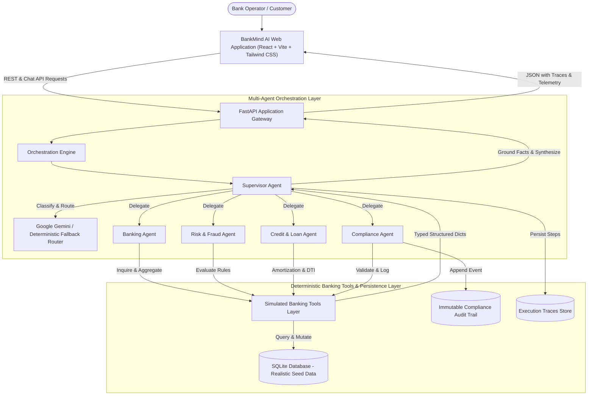
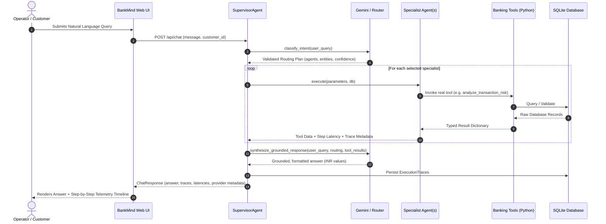
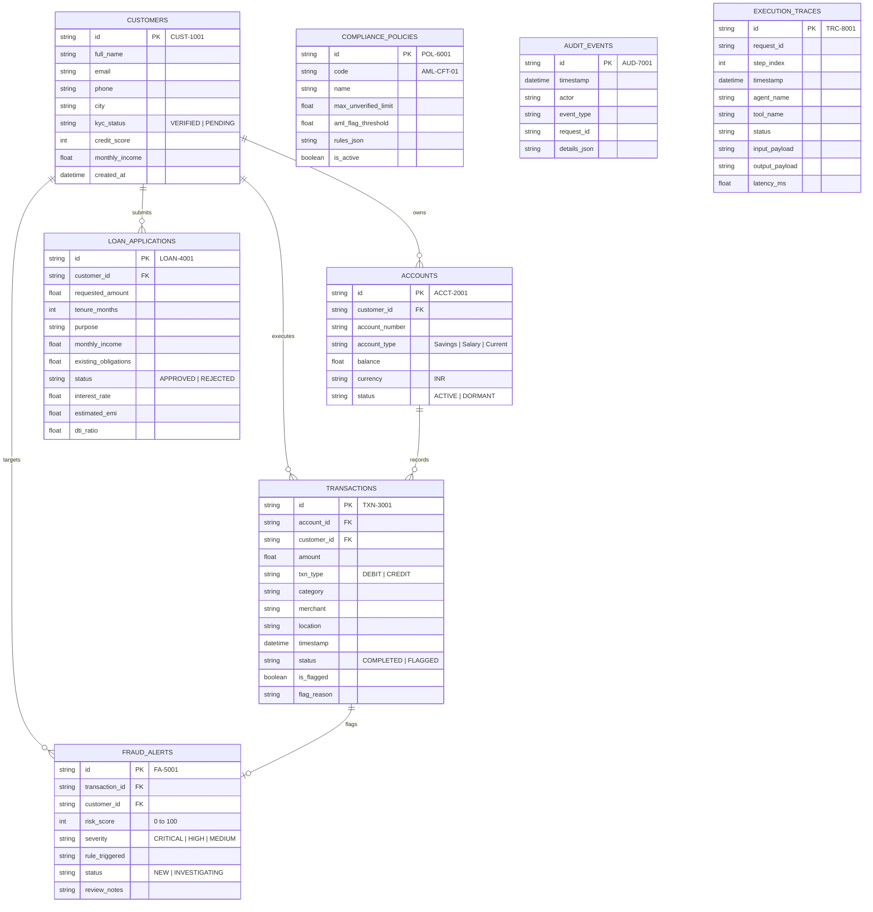

# BankMind AI — System Architecture & Multi-Agent Specifications

## 1. System Overview

BankMind AI is a simulated real-time banking operations and intelligence platform engineered to evaluate multi-agent orchestration over deterministic banking tools. The system allows users and bank operators to query accounts, analyze spending, investigate suspicious transactions, evaluate loan eligibility, and review audit trails using natural language.

The platform combines the reasoning and classification capabilities of **Google Gemini** (via the official `google-genai` Python SDK) with strict **deterministic guardrails** and real Python banking tool executions backed by an ACID-compliant **SQLite** database.

---

## 2. Multi-Agent Topology & Specialist Responsibilities

The system rejects fragile monolithic LLM prompt chains in favor of a **Supervisor-Worker specialist topology**:

### A. SupervisorAgent
- **Role**: Master orchestrator and intent classification director.
- **Workflow**:
  1. Accepts user natural-language input.
  2. Decomposes intent using structured JSON schema.
  3. Identifies required specialist agents and extracts entities (`customer_id`, `transaction_id`, loan terms).
  4. Dispatches calls to specialists sequentially or in coordination.
  5. Aggregates tool outputs and synthesizes a final grounded answer.
  6. Records granular execution traces (step index, agent name, tool invoked, raw input/output payloads, latency in ms).
- **Core Guardrail**: *Never fabricates a tool execution or financial balance.* If an entity does not exist or a tool returns an error, the supervisor surfaces the real database response.

### B. BankingAgent
- **Role**: Core banking operations specialist.
- **Capabilities**:
  - `get_customer(customer_id)`: Customer profile lookup.
  - `search_customers(query)`: Name, ID, email, or city lookup.
  - `get_accounts(customer_id)`: Retrieves active accounts and balances.
  - `get_transactions(customer_id, limit, filters)`: Ledger queries with category and debit/credit filters.
  - `calculate_spending_summary(customer_id)`: Aggregates total debits, credits, net cashflow, and category distribution.

### C. RiskFraudAgent
- **Role**: Fraud detection and AML surveillance specialist.
- **Capabilities**:
  - `analyze_transaction_risk(transaction_id)`: Applies deterministic fraud rules against real transaction data.
  - `list_fraud_alerts(status)`: Queries active surveillance alerts.
- **Deterministic Heuristic Rules**:
  1. **High-Risk Merchant/Category**: Flags cryptocurrency P2P desks, offshore casinos, and overseas forex clearing.
  2. **AML Amount Threshold**: Flags transactions exceeding statutory single ceilings (₹200,000 for retail accounts).
  3. **Geographic Origin Anomaly**: Flags transactions originating from offshore hubs (Dubai, Zurich, Cayman, London) differing from customer domicile.
  4. **Structuring & Velocity**: Flags rapid debits within short intervals just below reporting limits (e.g. repeated ₹49,999).
- **Output**: Risk score (0–100), severity (`LOW`, `MEDIUM`, `HIGH`, `CRITICAL`), triggered rules list, and recommended action (`BLOCK_AND_VERIFY`, `HOLD_FOR_MANUAL_REVIEW`, `APPROVE_TRANSACTION`).

### D. CreditLoanAgent
- **Role**: Credit underwriting and lending analyst.
- **Capabilities**:
  - `calculate_emi(principal, annual_interest_rate, tenure_months)`: Mathematical amortization schedule calculation.
  - `calculate_loan_eligibility(customer_id, requested_amount, tenure_months)`: Full automated underwriting check.
  - `get_loan_application(application_id)`: Retrieves historical loan applications.
- **Deterministic Underwriting Criteria**:
  - **KYC Mandate**: Customer KYC must be `VERIFIED`. Non-verified or pending customers are rejected.
  - **Credit Score Minimum**: Requires minimum bureau score of 650.
  - **Debt-To-Income (DTI) Ceiling**: Proposed monthly EMI plus existing monthly obligations must not exceed 40% of gross monthly income.
- **Disclaimer**: Every output includes a non-binding simulated advisory label.

### E. ComplianceAgent
- **Role**: Regulatory governance and audit officer.
- **Capabilities**:
  - `get_compliance_policy(policy_name)`: Retrieves codified policy rules (AML-CFT-01, KYC-VERIF-02, CREDIT-DTI-03).
  - `write_audit_event(event)`: Appends immutable records to the `audit_events` ledger for security tracking.

---

## 3. Data Models & SQLite Schema

---

## 4. Google Gemini SDK Integration & Deterministic Demo Mode

### Integration Architecture
The system integrates with the official **Google Gen AI Python SDK** (`google-genai`). The environment variable `GEMINI_API_KEY` is loaded securely via `.env`.

When configured:
1. `GEMINI_MODEL` defaults to `gemini-2.5-flash` (or user-defined model).
2. The Supervisor prompts Gemini for structured intent classification.
3. Once specialist agents return verified tool outputs from SQLite, Gemini synthesizes a cohesive, professional banking explanation grounded strictly in those tool results.

### Deterministic Demo-Mode Fallback
If `GEMINI_API_KEY` is absent, empty, or network access is restricted:
- BankMind AI automatically switches to **Deterministic Demo Mode**.
- An intelligent rule-based orchestrator uses regex and deterministic heuristic routing to fulfill all 5 core use cases with 100% precision.
- The UI reflects the active provider badge (`Deterministic Demo Mode`) so the user is never misled.
- The system never pretends that Gemini was called when it was not.

---

## 5. Security & Safety Controls

1. **Simulated Environment Guardrails**: All calculations, customer accounts, and money transfers are strictly simulated educational models. No connections to actual SWIFT, UPI, or core banking networks exist.
2. **Read-Only MVP Tools**: The current MVP provides read-only inspection, risk scoring, and eligibility modeling to eliminate unintended modification risks.
3. **Zero Credential Leaks**: API keys are isolated to server-side `.env` files and never rendered in frontend state or API payloads.
4. **Input Sanitation & Validation**: All endpoint payloads are validated using Pydantic v2 schemas with bounds checking.
5. **Prompt Injection Resistance**: The supervisor treats user input purely as an untrusted intent source. Tool invocations require typed arguments extracted from database entities rather than open-ended shell or code execution.
6. **Immutable Auditing**: Every risk check, policy verification, and loan assessment writes an append-only audit record in `audit_events`.
